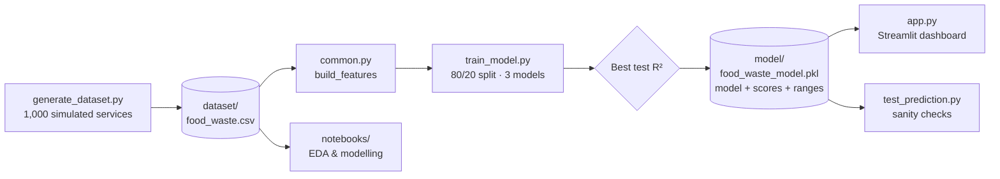
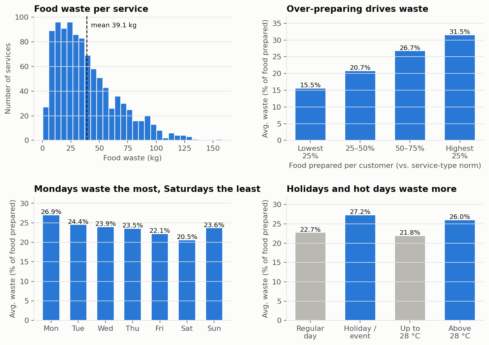
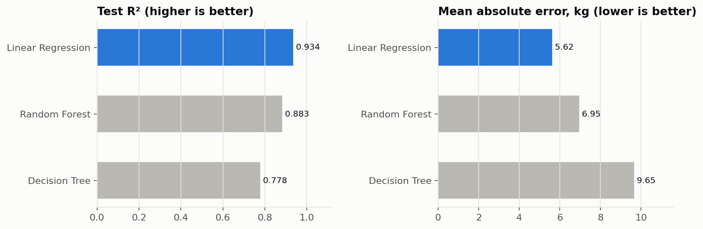
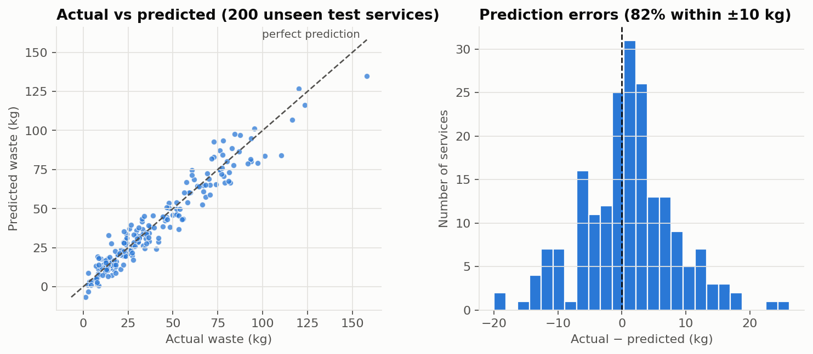
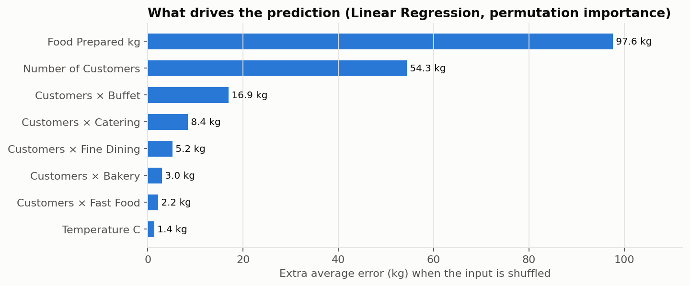

<div align="center">

# 🍲 ZeroWaste — Food Waste Prediction System

**Forecast how much food a kitchen will waste *before* service starts — and what it will cost.**


</div>

---

## 🎓 Course Submission

| | |
| :--- | :--- |
| **Course** | Predictive Analysis |
| **Project** | ZeroWaste — Food Waste Prediction System |
| **Submitted by** | Namita Chhabra |
| **Student ID** | 2427030677 |
| **Submitted** | October 2026 |

---

## 📑 Contents

1. [At a Glance](#-at-a-glance)
2. [Problem Statement](#-problem-statement)
3. [Solution Pipeline](#-solution-pipeline)
4. [Dataset](#-dataset)
5. [Exploratory Data Analysis](#-exploratory-data-analysis)
6. [Methodology](#-methodology)
7. [Results](#-results)
8. [Web Application](#-web-application)
9. [Getting Started](#-getting-started)
10. [Project Structure](#-project-structure)
11. [Testing & Reproducibility](#-testing--reproducibility)
12. [Limitations & Future Work](#-limitations--future-work)
13. [Viva / Interview Q&A](#-viva--interview-qa)

---

## ⚡ At a Glance

| | |
| :--- | :--- |
| **Task** | Supervised regression: predict `Food_Waste_kg` for a single service |
| **Data** | 1,000 simulated kitchen services · 9 columns · 23 model features |
| **Models compared** | Linear Regression · Decision Tree · Random Forest |
| **Selected model** | **Linear Regression**, chosen automatically by best test R² |
| **Test performance** | **R² = 0.934** · MAE = 5.62 kg · RMSE = 7.42 kg · 82% of predictions within ±10 kg |
| **Key design choice** | No data leakage: only inputs known *before* service are used |
| **Deliverable** | 5-page Streamlit app with multi-currency loss estimates and prep recommendations |

---

## 🎯 Problem Statement

On average, the kitchens in this dataset throw away **23.6% of the food they prepare**. They prepare too much because tomorrow's demand is uncertain: customer counts change, holidays disrupt patterns, and hot weather lowers appetite and speeds up spoilage.

**Objective:** given what a kitchen knows the morning of service, predict how many kilograms will be wasted so that the manager can:

1. **Anticipate** waste before cooking starts.
2. **Quantify** the financial loss in local currency (INR, USD, EUR, GBP, AED, CAD, AUD).
3. **Act** on a recommended preparation quantity.

---

## 🔄 Solution Pipeline



A single feature function in [`common.py`](common.py) is shared by training, the app and the tests, so the model always gets identical inputs everywhere. The pickle file stores the model **and** its test scores, input ranges and importances, so the app never shows hard-coded numbers.

---

## 📊 Dataset

> **Synthetic data.** No public dataset records per-service waste together with these drivers, so the data is simulated from a transparent model of kitchen behaviour ([`generate_dataset.py`](generate_dataset.py), fixed seed `42`).

**How each service is simulated**

1. Expected demand = customers × typical portion for the service type (Buffet 0.60 kg, Catering 0.55, Fine Dining 0.50, Fast Food 0.45, Bakery 0.35).
2. The kitchen prepares that demand plus its own safety margin (**5–40% extra**, different for every service).
3. Actual consumption varies with the day of the week, holidays (−7%), heat above 28 °C, and random noise (±5%).
4. Waste = prepared − consumed + spoilage (buffet/catering/bakery display losses, heat) + noise.

**Data dictionary**

| Column | Type | Description | Model input? |
| :--- | :--- | :--- | :---: |
| `Number_of_Customers` | int | Expected customers (40–500) | ✅ |
| `Food_Prepared_kg` | float | Food prepared (kg) | ✅ |
| `Food_Category` | category | Buffet, Fast Food, Fine Dining, Bakery, Catering | ✅ |
| `Day_of_Week` | category | Monday … Sunday | ✅ |
| `Holiday_Event` | 0/1 | Holiday or special event | ✅ |
| `Previous_Food_Waste_kg` | float | Waste at the kitchen's previous service | ✅ |
| `Temperature_C` | float | Ambient temperature (15–38 °C) | ✅ |
| `Food_Consumed_kg` | float | Food actually eaten, **known only after service** | ❌ *(leakage)* |
| `Food_Waste_kg` | float | **Target:** food wasted (kg) | 🎯 |

---

## 🔍 Exploratory Data Analysis



**What the data says**

- **Over-preparation is the main driver.** Kitchens in the top quarter for food per customer waste **31.5%** of what they make, about twice the **15.5%** of the bottom quarter.
- **Mondays waste the most (26.9%), Saturdays the least (20.5%).** Turnout is weakest early in the week, but kitchens don't scale prep down to match.
- **Holidays and events add risk.** Waste rises from 22.7% to **27.2%** because demand is harder to predict.
- **Heat matters.** Above 28 °C, waste rises from 21.8% to **26.0%**: people eat less and food spoils faster.
- Waste per service is **right-skewed** (mean 39.1 kg, median 32.7 kg). Large buffets and catering events produce the long tail.

---

## 🧪 Methodology

### 1. Avoiding data leakage

`Food_Consumed_kg` is in the dataset, but a kitchen only learns it **after** service, and waste is essentially *prepared − consumed*. Using it as an input makes the model look perfect while being useless for planning:

| Inputs used | Test R² | Usable before service? |
| :--- | :---: | :---: |
| With `Food_Consumed_kg` | 0.999 | ❌ No (the answer is in the inputs) |
| **Without it (this project)** | **0.934** | ✅ Yes |

### 2. Feature engineering ([`common.py`](common.py))

| Feature | Why |
| :--- | :--- |
| 5 numeric inputs | Scale, quantity, events, history, weather |
| One-hot `Food_Category` (5) and `Day_of_Week` (7) | Categorical → numeric without implying an order |
| `Prepared_per_Customer` | How generous the kitchen is being, regardless of size |
| `Customers × Category` (5) | Lets a linear model learn a **different portion size per service type** |

### 3. Training & selection ([`train_model.py`](train_model.py))

- 80/20 train-test split (`random_state=42`): 800 rows to train, 200 held out.
- Three regressors: `LinearRegression`, `DecisionTreeRegressor(max_depth=10)`, `RandomForestRegressor(n_estimators=100)`.
- The model with the **highest test R²** is saved automatically, so there is no hand-picking.
- **Permutation importance** on the test set explains which inputs drive predictions. It works for any model type.

### 4. Evaluation metrics

$$R^2 = 1 - \frac{\sum_i (y_i - \hat{y}_i)^2}{\sum_i (y_i - \bar{y})^2} \qquad \text{MAE} = \frac{1}{n}\sum_i |y_i - \hat{y}_i| \qquad \text{RMSE} = \sqrt{\frac{1}{n}\sum_i (y_i - \hat{y}_i)^2}$$

- **R²**: share of the variation in waste that the model explains (1.0 = perfect).
- **MAE**: typical error in kilograms, the easiest to explain to a kitchen manager.
- **RMSE**: like MAE, but penalises large misses more heavily.

---

## 🏆 Results

| Model | Test R² | MAE (kg) | RMSE (kg) | |
| :--- | :---: | :---: | :---: | :--- |
| **Linear Regression** | **0.934** | **5.62** | **7.42** | ✅ Selected |
| Random Forest | 0.883 | 6.95 | 9.90 | |
| Decision Tree | 0.778 | 9.65 | 13.65 | |



**Why the simplest model wins.** Waste is essentially *prepared − (customers × portion)*, which is a linear relationship once the `Customers × Category` features exist. Tree models have to approximate that straight line with steps and **cannot predict beyond the values they saw in training**, so they lose accuracy at the extremes.



Predictions follow the 1:1 line closely across the full range. Errors are centred on zero with no systematic bias, and **82% of services are predicted within ±10 kg**.



**Reading the model.** The fitted coefficients have a direct business meaning:

| Finding | Effect on predicted waste |
| :--- | :--- |
| Each extra kg prepared (same customers) | **+0.98 kg waste**: almost every surplus kg is thrown away |
| Holiday / special event | **+9.4 kg** |
| Monday vs Saturday | **+9.5 kg** |
| Each +1 °C temperature | **+0.56 kg** |

---

## 🖥️ Web Application

`streamlit run app.py` opens a 5-page dashboard:

| Page | What it does |
| :--- | :--- |
| 🔮 **Predict Food Waste** | Enter tomorrow's plan → predicted waste (kg), financial loss in 7 currencies, waste %, and a **suggested prep quantity** |
| 📊 **EDA Visualizations** | Six interactive Matplotlib charts, including actual-vs-predicted on test data and feature importance |
| 📋 **Dataset Explorer** | Preview, `describe()`, data types and null checks |
| 🎯 **Model Comparison** | Live R² / MAE / RMSE for all three models from the last training run |
| 📓 **Guide & Q&A** | Setup steps and viva questions, with answers that update from the trained model |

**Built-in safeguards**
- Inputs are limited to the range the model was trained on.
- A warning appears when food per customer is unusual for the chosen service type.
- Predictions are never negative.
- On first launch the app generates the dataset and trains the model by itself.

---

## 🚀 Getting Started

```bash
# 1. Clone and install
git clone https://github.com/namitachhabra21-droid/ZeroWaste.git
cd ZeroWaste
pip install -r requirements.txt

# 2. (Optional) rebuild data and model; the app does this automatically if missing
python generate_dataset.py
python train_model.py

# 3. Launch the dashboard → http://localhost:8501
streamlit run app.py
```

**Optional extras**

```bash
python test_prediction.py      # run sanity checks
python build_notebook.py       # regenerate notebooks/food_waste_analysis.ipynb
python docs/make_figures.py    # regenerate the README charts
```

---

## 📁 Project Structure

```
ZeroWaste/
├── app.py                      # Streamlit dashboard (5 pages)
├── common.py                   # Shared paths + feature engineering
├── generate_dataset.py         # Synthetic data simulation
├── train_model.py              # Train, compare, select & save model
├── test_prediction.py          # Sanity checks (plain Python or pytest)
├── build_notebook.py           # Generates the analysis notebook
├── requirements.txt
├── dataset/
│   └── food_waste.csv          # 1,000 simulated services
├── notebooks/
│   └── food_waste_analysis.ipynb
├── docs/
│   ├── make_figures.py         # Builds the charts in this README
│   └── images/
└── model/                      # Created by train_model.py (git-ignored)
```

---

## ✅ Testing & Reproducibility

`python test_prediction.py` verifies that:

- [x] `Food_Consumed_kg` is **not** a model input (no leakage)
- [x] The saved model is the best-scoring one
- [x] Default predictions are in a realistic range
- [x] Preparing more food predicts more waste
- [x] No meaningfully negative predictions across each service type's training range

Every random step uses seed `42`, so the data, the split and all reported numbers are fully reproducible.

---

## 🔭 Limitations & Future Work

| Limitation | Next step |
| :--- | :--- |
| Data is simulated, not collected from real kitchens | Validate on real point-of-sale and waste-log data |
| The model can't learn from kitchens that **under**-prepare (none exist in the data) | Collect shortage events and model waste as `max(0, …)` |
| A single 80/20 split | k-fold cross-validation and hyper-parameter tuning |
| One prediction per service | Forecast by dish or ingredient for finer-grained prep plans |
| Fixed cost per kg per country | Live exchange rates and ingredient-level costing |

---

## 🎤 Viva / Interview Q&A

<details>
<summary><b>What problem does this project solve?</b></summary>

It predicts food waste in kilograms before a kitchen starts cooking, converts it into a financial loss, and recommends how much to prepare, turning a guess into a data-driven decision.
</details>

<details>
<summary><b>Why isn't Food Consumed used as an input?</b></summary>

It is only known after service, and waste ≈ prepared − consumed. Including it is **data leakage**: test R² jumps to 0.999, but the model can't be used to plan tomorrow's service.
</details>

<details>
<summary><b>Why did Linear Regression beat Random Forest?</b></summary>

The underlying relationship is close to linear once portion size per service type is captured by the `Customers × Category` features. Trees approximate straight lines with steps and can't extrapolate beyond the training range. The choice is made automatically by best test R².
</details>

<details>
<summary><b>What does R² = 0.934 mean?</b></summary>

The model explains about 93% of the variation in food waste across unseen services. In practical terms, the average error (MAE) is 5.6 kg.
</details>

<details>
<summary><b>What is permutation importance?</b></summary>

Shuffle one input column in the test set and measure how much worse the predictions get. A large increase in error means the model depends heavily on that input. It works for any model type.
</details>

<details>
<summary><b>Why use the synthetic data?</b></summary>

No public dataset links per-service waste to these operational drivers. A transparent simulation makes the ground truth known, so we can check that the model recovers real effects (e.g. +0.98 kg waste per extra kg prepared).
</details>

<details>
<summary><b>How is the model used by the app?</b></summary>

`train_model.py` pickles the model together with its scores, test predictions, feature importances and valid input ranges. The Streamlit app loads that single file, so everything it displays comes from the latest training run.
</details>

---

<div align="center">

**Submitted by Namita Chhabra · Student ID 2427030677**
Predictive Analysis — Course Project

*Built with Python · Pandas · NumPy · Matplotlib · scikit-learn · Streamlit*

</div>
